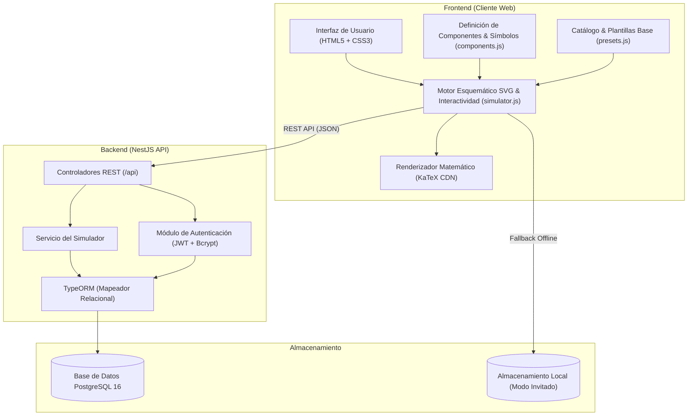

<p align="center">
  
</p>

<h1 align="center">DigiLab Studio</h1>

<p align="center">
  <strong>Entorno de Automatización de Diseño Electrónico (EDA) y Simulación Digital en Tiempo Real</strong>
</p>

<p align="center">
  Diseño esquemático puro, simulación interactiva, síntesis booleana automática y análisis de circuitos combinacionales TTL Serie 74LS.
</p>

<p align="center">
  
  
  
  
  
  
  
</p>

---

## 📑 Tabla de Contenidos

- [Visión General](#-visión-general)
- [Características Principales](#-características-principales)
- [Catálogo de Componentes Soportados](#-catálogo-de-componentes-soportados)
- [Circuitos Demostrativos Preconfigurados](#-circuitos-demostrativos-preconfigurados)
- [Análisis de Tabla de Verdad y Expresiones SOP](#-análisis-de-tabla-de-verdad-y-expresiones-sop)
- [Arquitectura del Sistema](#-arquitectura-del-sistema)
- [Instalación y Puesta en Marcha](#-instalación-y-puesta-en-marcha)
  - [Opción 1: Despliegue Rápido con Docker Compose](#opción-1-despliegue-rápido-con-docker-compose-recomendado)
  - [Opción 2: Instalación Local Manual](#opción-2-instalación-local-manual)
- [Referencia de la API REST](#-referencia-de-la-api-rest)
- [Atajos de Teclado y Controles del Lienzo](#-atajos-de-teclado-y-controles-del-lienzo)
- [Estructura del Proyecto](#-estructura-del-proyecto)
- [Licencia](#-licencia)

---

## 🌟 Visión General

**DigiLab Studio** es una plataforma web integral de simulación y laboratorio virtual para la enseñanza y prototipado de **electrónica digital**. Permite construir diagramas esquemáticos con estándar IEEE, conectar cables ortogonales limpios en ángulo recto, rotar componentes con actualización dinámica de terminales, simular estados lógicos en tiempo real con detección de ciclos y generar automáticamente **Tablas de Verdad interactivas** y **expresiones booleanas en Suma de Productos (SOP)** formateadas con tipografía matemática $\LaTeX$.

---

## 🚀 Características Principales

### ⚡ 1. Simulación Lógica Interactiva en Tiempo Real
- **Motor de Eventos Discretos**: Propagación reactiva de niveles lógicos `0` (bajo / ~0V) y `1` (alto / +5V) con bucle de estabilización iterativo y detección de carreras críticas.
- **Terminales Interactivos**: Interruptores lógicos conmutables con un clic, fuentes de alimentación fija ($+V_{\text{CC}}$, $\text{GND}$), monitores luminosos LED y visualizadores hexadecimales/decimales de 4 bits.
- **Símbolos Esquemáticos Puros (IEEE)**: Sin tarjetas rectangulares genéricas; compuertas dibujadas fielmente en vectores SVG, multiplexores con geometría trapezoidal y bloques MSI con pinout normativo.

### 📐 2. Motor de Cableado Ortogonal Inteligente
- **Enrutamiento Manhatan Automático**: Algoritmo que calcula trayectorias limpias en ángulo recto ($90^\circ$) con segmentos horizontales y verticales adaptativos (`buildOrthogonalPath`).
- **Puntos de Unión (Junctions)**: Nodos de soldadura automáticos en derivaciones compartidas con capacidad de sacar ramificaciones en "T" mediante `Shift + Clic`.
- **Soporte Multiorientación**: Cálculo trigonométrico de pines en bordes Norte, Sur, Este y Oeste, adaptándose fluidamente al rotar compuertas $90^\circ$, $180^\circ$ o $270^\circ$.

### 📊 3. Tabla de Verdad Dual Interactiva
- **Modo Buses de Laboratorio**: Agrupa palabras de datos multivariable ($A$, $B$, $S$, $C_{\text{out}}$) mostrando valores binarios compactos (`0101`, `0011`, etc.) idénticos a los informes de laboratorio universitario.
- **Modo Bits Detallados**: Evaluación combinacional exhaustiva ($2^n$) con desglose de minitérminos individuales ($\sum m$).
- **Inyección Bidireccional en Tiempo Real**: Al pulsar cualquier fila de la tabla de verdad, los estados lógicos correspondientes se inyectan instantáneamente en las entradas del circuito sobre el lienzo.
- **Resaltado Activo**: La combinación activa en el lienzo se resalta de forma sincronizada en la tabla de verdad.

### 🧮 4. Síntesis y Análisis Algebraico con KaTeX
- **Generación Automática de Expresiones SOP**: Extracción formal de minitérminos y simplificación algebraica para cada salida del circuito.
- **Renderizado Matemático $\LaTeX$**: Fórmulas algebraicas de alta resolución como:
  $$S = A \oplus B \oplus C_{\text{in}} \qquad C_{\text{out}} = A \cdot B + C_{\text{in}} \cdot (A \oplus B)$$
  $$S = (A + B) \pmod{16} \qquad C_{\text{out}} = \left\lfloor \frac{A + B}{16} \right\rfloor$$

### 🗂️ 5. Espacio de Trabajo Multipestaña y Productividad
- **Múltiples Lienzos Simultáneos**: Trabaja en varios circuitos a la vez mediante pestañas aisladas con su propia pila de Deshacer/Rehacer (`Ctrl+Z` / `Ctrl+Y`), nivel de zoom y posición de paneo.
- **Panel Inferior Redimensionable**: Barra de arrastre vertical para expandir la tabla de verdad o colapsarla para maximizar el área de diseño.
- **Inspector de Propiedades**: Ajuste milimétrico de posición $(X, Y)$ mediante controles de paso fino (*steppers*), cambio de etiquetas y rotación.
- **Protección Anti-Parpadeo Síncrona**: Guarda y restaura el estado de sesión en tiempo cero al recargar con `F5` sin mostrar pantallas intermedias.

### ☁️ 6. Persistencia y Nube
- **Autenticación JWT Segura**: Registro e inicio de sesión con contraseñas encriptadas mediante `bcrypt`.
- **Modo Invitado Offline**: Funcionalidad 100% operativa sin cuenta con almacenamiento en `localStorage`.
- **Exportación e Importación**: Descarga y carga de circuitos en formato estructurado `.JSON`.

---

## 🎛️ Catálogo de Componentes Soportados

| Categoría | Componente | Identificador / CI | Entradas | Salidas | Ecuación / Función |
| :--- | :--- | :--- | :---: | :---: | :--- |
| **Entradas y Salidas** | Entrada Binaria | `IN` | 0 | 1 | Terminal lógico conmutable (0 / 1) |
| | Monitor LED | `OUT` | 1 | 0 | Indicador visual de estado lógico |
| | Display Hexadecimal | `HEX` | 4 ($D_3..D_0$) | 0 | Visualizador numérico Hex/Dec (0..F) |
| | Fuente +Vcc | `+5V` | 0 | 1 | Nivel alto constante ($1$) |
| | Tierra GND | `0V` | 0 | 1 | Nivel bajo constante ($0$) |
| **Compuertas Básicas** | AND (2 In) | `74LS08` | 2 | 1 | $Y = A \cdot B$ |
| | OR (2 In) | `74LS32` | 2 | 1 | $Y = A + B$ |
| | NOT (Inversor) | `74LS04` | 1 | 1 | $Y = \overline{A}$ |
| | NAND (2 In) | `74LS00` | 2 | 1 | $Y = \overline{A \cdot B}$ |
| | NOR (2 In) | `74LS02` | 2 | 1 | $Y = \overline{A + B}$ |
| | XOR (2 In) | `74LS86` | 2 | 1 | $Y = A \oplus B$ |
| | XNOR (Equivalencia) | `74LS266` | 2 | 1 | $Y = \overline{A \oplus B}$ |
| **Compuertas Múltiples**| AND 3 Entradas | `74LS11` | 3 | 1 | $Y = A \cdot B \cdot C$ |
| | AND 4 Entradas | `74LS21` | 4 | 1 | $Y = A \cdot B \cdot C \cdot D$ |
| | AND 8 Entradas | `AND-8` | 8 | 1 | $Y = I_0 \cdot I_1 \cdots I_7$ |
| | NAND 3 Entradas | `74LS10` | 3 | 1 | $Y = \overline{A \cdot B \cdot C}$ |
| | NAND 4 Entradas | `74LS20` | 4 | 1 | $Y = \overline{A \cdot B \cdot C \cdot D}$ |
| | NAND 8 Entradas | `74LS30` | 8 | 1 | $Y = \overline{I_0 \cdot I_1 \cdots I_7}$ |
| | OR 3 Entradas | `74LS4075` | 3 | 1 | $Y = A + B + C$ |
| | OR 4 Entradas | `74LS4072` | 4 | 1 | $Y = A + B + C + D$ |
| | OR 5/8 In (SOP) | `SOP-OR` | 5 u 8 | 1 | $F = \sum m_i$ |
| | NOR 3/4 Entradas | `74LS27` / `74LS4002` | 3 o 4 | 1 | Inversión de suma lógica |
| | XOR 3 In (Paridad) | `PARITY-ODD` | 3 | 1 | Paridad impar ($A \oplus B \oplus C$) |
| **Aritmética Modular** | Medio Sumador | `M.S.` | 2 ($A, B$) | 2 ($S, C_{\text{out}}$) | $S = A \oplus B \quad C_{\text{out}} = A \cdot B$ |
| | Sumador Completo | `S.C.` | 3 ($A, B, C_{\text{in}}$) | 2 ($S, C_{\text{out}}$) | $S = A \oplus B \oplus C_{\text{in}}$ |
| | Sumador de 4 Bits | `74LS283` | 9 | 5 | $\Sigma = A + B + C_0$ (4 bits + acarreo) |
| | Comparador 1 Bit | `COMP` | 2 ($A, B$) | 3 ($>, =, <$) | Magnitud de 1 bit |
| | Comparador 4 Bits | `74LS85` | 11 | 3 ($>, =, <$) | Comparador con entradas de cascada |
| **Selectores & MUX** | MUX 2:1 | `74LS157` | 3 ($I_0, I_1, S_0$) | 1 ($Y$) | Trapecio selector de 2 canales |
| | MUX 4:1 | `74LS153` | 6 ($I_0..I_3, S_1, S_0$) | 1 ($Y$) | Trapecio selector de 4 canales |
| | MUX 8:1 | `74LS151` | 11 ($E_0..E_7, S_2..S_0$) | 2 ($Z, \overline{Z}$) | Selector MSI de 8 canales |
| | DEMUX 1:4 | `74LS139` | 3 ($I, S_1, S_0$) | 4 ($O_0..O_3$) | Distribuidor 1 a 4 líneas |
| | Decodificador 3:8 | `74LS138` | 3 ($X, Y, Z$) | 8 ($S_0..S_7$) | Generador de 8 minitérminos |

---

## 💡 Circuitos Demostrativos Preconfigurados

DigiLab incluye plantillas base de referencia listas para abrir con un clic desde el menú desplegable **"Ejemplo"**:

1. **Sumador de 4 bits en Cascada (M.S. + 3 S.C.)**:
   - Arquitectura modular canónica de suma binaria por propagación de acarreo (*Ripple Carry Adder*).
   - Bit 0 implementado con 1 **Medio Sumador (`M.S.`)** y bits 1 a 3 con **Sumadores Completos (`S.C.`)**.
   - Enrutamiento horizontal recto del bus de acarreos ($C_0 \to C_1 \to C_2 \to C_3$).
   - 8 entradas interactivas ($A_3..A_0$, $B_3..B_0$) y 5 salidas ($S_4/C_{\text{out}}, S_3..S_0$).
2. **Sumador Completo (1 bit con compuertas discretas)**:
   - Implementación pura a nivel de compuertas con 2 $\text{XOR}$, 2 $\text{AND}$ y 1 $\text{OR}$.
3. **Semisumador Binario (Half-Adder)**:
   - Circuito elemental con compuertas $\text{XOR}$ (Suma) y $\text{AND}$ (Acarreo).
4. **Comparador de 4 bits (CI 74LS85)**:
   - Análisis de palabras binarias $A$ vs $B$ con entradas de expansión en cascada ($I_{>}, I_{=}, I_{<}$).
5. **Multiplexor 4:1 (CI 74LS153)**:
   - Selector digital de datos controlado por líneas $S_1$ y $S_0$.
6. **Sumador de 4 bits integrado (CI 74LS283)**:
   - Circuito Integrado comercial DIP-16 para adición binaria rápida.
7. **Decodificador Binario 3 a 8 (CI 74LS138)**:
   - Conversión de 3 bits de dirección en 8 líneas activas para arquitecturas SOP.

---

## 📈 Análisis de Tabla de Verdad y Expresiones SOP

El dock inferior de DigiLab cuenta con un motor analítico avanzado:

```
┌────────────────────────────────────────────────────────┐
│ N.°  │   A   │   B   │ S (4 bits) │ Cout │ Operación   │
├──────┼───────┼───────┼────────────┼──────┼─────────────┤
│  1   │ 0000  │ 0000  │    0000    │  0   │ 0 + 0 = 0   │
│  2   │ 0001  │ 0010  │    0011    │  0   │ 1 + 2 = 3   │
│  3   │ 0011  │ 0100  │    0111    │  0   │ 3 + 4 = 7   │
│  4   │ 0101  │ 0011  │    1000    │  0   │ 5 + 3 = 8   │
│  5   │ 0111  │ 0010  │    1001    │  0   │ 7 + 2 = 9   │
│  8   │ 1100  │ 0100  │    0000    │  1   │ 12 + 4 = 16 │
│  10  │ 1111  │ 1111  │    1110    │  1   │ 15 + 15 = 30│
└────────────────────────────────────────────────────────┘
```

- **Pestaña 1: Tabla de Verdad & SOP**: Conmutador entre vista agrupada por buses y vista de bits individuales.
- **Pestaña 2: Resultados en Tiempo Real**: Lista de voltajes, niveles lógicos y estados actuales de cada pin del circuito.
- **Pestaña 3: Guía y Referencia**: Resumen teórico de familias lógicas TTL, diagramas de pines (pinouts) y teoremas de álgebra de Boole.

---

## 🏛️ Arquitectura del Sistema



---

## 🛠️ Instalación y Puesta en Marcha

### Prerrequisitos
- [Node.js](https://nodejs.org/) v18.0.0 o superior.
- [npm](https://www.npmjs.com/) v9.0.0 o superior.
- [Docker](https://www.docker.com/) y [Docker Compose](https://docs.docker.com/compose/) (opcional, para base de datos contenerizada).

---

### Opción 1: Despliegue Rápido con Docker Compose (Recomendado)

1. **Clonar el repositorio**:
   ```bash
   git clone https://github.com/MaYoNGY/DigiLab.git
   cd DigiLab
   ```

2. **Configurar variables de entorno**:
   Copia el archivo de plantilla `.env.example` para tu entorno local:
   ```bash
   cp backend/.env.example backend/.env
   ```
   > 🔒 **Seguridad**: Configura tus propias credenciales locales en `.env`. Nunca compartas ni subas a repositorios tus contraseñas o el `JWT_SECRET` de producción. En plataformas en la nube (como Vercel), las variables se configuran de forma segura y privada desde el panel de control de entorno.

3. **Iniciar el contenedor de PostgreSQL**:
   ```bash
   docker compose up -d
   ```

4. **Instalar dependencias y levantar el servidor NestJS**:
   ```bash
   cd backend
   npm install
   npm run start:dev
   ```

5. **Abrir en el navegador**:
   Visita `http://localhost:3000` para comenzar a diseñar circuitos.

---

### Opción 2: Instalación Local Manual

Si ya tienes un servidor PostgreSQL local en ejecución:

1. **Configurar la base de datos**:
   Crea la base de datos en PostgreSQL:
   ```sql
   CREATE DATABASE digilab_db;
   ```

2. **Instalar dependencias del Backend**:
   ```bash
   cd backend
   npm install
   ```

3. **Compilar y Ejecutar en modo desarrollo**:
   ```bash
   npm run start:dev
   ```

4. **Modo Estático Independiente (Solo Frontend)**:
   Si deseas probar el simulador sin levantar base de datos ni backend, puedes abrir directamente `frontend/index.html` con la extensión *Live Server* de Visual Studio Code o cualquier servidor HTTP estático (`npx serve frontend`). Todas las funciones lógicas, tablas de verdad y guardado local en modo invitado funcionarán al 100%.

---

## 📡 Referencia de la API REST

La API del simulador se expone bajo el prefijo `/api`:

### Autenticación (`/api/auth`)
| Método | Endpoint | Descripción | Autenticación |
| :---: | :--- | :--- | :---: |
| `POST` | `/api/auth/register` | Registra una nueva cuenta de laboratorio | No |
| `POST` | `/api/auth/login` | Inicia sesión y retorna token JWT | No |
| `GET` | `/api/auth/me` | Obtiene el perfil del usuario autenticado | Bearer Token |

### Simulador y Circuitos (`/api/simulator`)
| Método | Endpoint | Descripción | Autenticación |
| :---: | :--- | :--- | :---: |
| `GET` | `/api/simulator/health` | Estado del backend y base de datos | No |
| `GET` | `/api/simulator/catalog` | Obtiene el catálogo de componentes digitales | No |
| `GET` | `/api/simulator/presets` | Lista de circuitos demostrativos preconfigurados | No |
| `GET` | `/api/simulator/my-circuits` | Lista los circuitos guardados por el usuario | Bearer Token |
| `POST` | `/api/simulator/circuits` | Guarda o actualiza un circuito en la nube | Bearer Token |
| `DELETE` | `/api/simulator/circuits/:id`| Elimina un circuito guardado por ID | Bearer Token |

---

## ⌨️ Atajos de Teclado y Controles del Lienzo

| Acción | Control / Atajo | Descripción |
| :--- | :---: | :--- |
| **Alternar Entrada** | `Clic` sobre el círculo | Alterna el nivel lógico entre `0` y `1` |
| **Crear Cable** | `Arrastrar` desde pin | Inicia el trazado ortogonal hacia otro terminal |
| **Derivar Señal (T-Tap)** | `Shift + Clic` en cable | Crea una bifurcación en el cable con punto de unión |
| **Eliminar Cable** | `Clic` o `Clic Secundario` | Elimina la conexión seleccionada |
| **Deshacer** | `Ctrl + Z` | Revierte la última acción en el lienzo |
| **Rehacer** | `Ctrl + Y` | Restaura la acción deshecha |
| **Rotar Componente** | `R` | Rota el componente seleccionado $90^\circ$ en sentido horario |
| **Duplicar Componente**| `Ctrl + D` | Clona el componente activo con una nueva etiqueta |
| **Eliminar Componente**| `Supr` o `Delete` | Elimina el nodo y sus cables asociados |
| **Paneo del Lienzo** | `Espacio + Arrastre` / `Botón Central` | Desplaza la vista por el espacio de trabajo |
| **Zoom In / Out** | `Rueda del Ratón` | Amplía o reduce el factor de escala del lienzo |
| **Restablecer Vista** | `Botón [100%]` | Centra el lienzo y devuelve el zoom al 100% |

---

## 📂 Estructura del Proyecto

```text
DigiLab/
├── backend/                        # Servidor NestJS y API REST
│   ├── src/
│   │   ├── auth/                   # Módulo de Autenticación (JWT, Bcrypt, Passport)
│   │   │   ├── auth.controller.ts
│   │   │   ├── auth.service.ts
│   │   │   └── user.entity.ts
│   │   ├── simulator/              # Lógica de circuitos, catálogo y persistencia
│   │   │   ├── circuit.entity.ts
│   │   │   ├── simulator.controller.ts
│   │   │   └── simulator.service.ts
│   │   ├── app.module.ts           # Módulo principal y configuración TypeORM
│   │   └── main.ts                 # Bootstrap de la aplicación y soporte Vercel
│   ├── package.json
│   └── tsconfig.json
│
├── frontend/                       # Aplicación Cliente (SPA Vanilla)
│   ├── css/
│   │   └── styles.css              # Sistema de diseño, temas, layout y componentes
│   ├── js/
│   │   ├── components.js           # Definiciones esquemáticas puras IEEE y lógica booleana
│   │   ├── presets.js              # Plantillas demostrativas y catálogo fallback
│   │   └── simulator.js            # Motor del simulador, cables, eventos y KaTeX
│   ├── favicon.ico                 # Icono del navegador
│   ├── favicon.png                 # Icono rasterizado para dispositivos móviles
│   ├── favicon.svg                 # Icono vectorial escalable (Compuerta AND)
│   └── index.html                  # Estructura principal y maquetación de la interfaz
│
├── docker-compose.yml              # Configuración de contenedor PostgreSQL
├── vercel.json                     # Configuración de despliegue serverless en Vercel
├── package.json                    # Scripts globales de compilación y arranque
└── README.md                       # Documentación principal del proyecto
```

---

## 📄 Licencia

Este proyecto se encuentra bajo la Licencia **MIT**. Eres libre de utilizarlo, modificarlo y distribuirlo con fines académicos o comerciales.

---

<p align="center">
  Desarrollado para el estudio, análisis y diseño de <strong>Sistemas y Circuitos Digitales</strong>.
</p>
